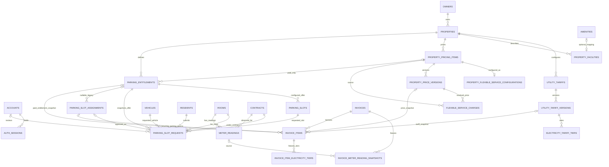

# Database V1.13 candidate — Resident Parking requests ERD

This V1.13 candidate extends the V1.12 schema with configured slot offers and Resident parking requests. The diagram is based on the existing Owner/Property, billing, and parking model; the physical database remains V1.12 until its guarded migration and catalog validation pass.

## Notes

- `invoices.snapshot_kind` is `NOT_FINALIZED`, `LEGACY_AGGREGATE`, or `ITEMIZED`. Existing V1.6 drafts remain unfinalized; existing finalized rows are aggregate-only and receive no synthetic items.
- `invoice_items` are authoritative for newly finalized itemized invoices. Compatibility aggregate fields reconcile to the category item sums and grand total.
- Composite tenant FKs are used where V1.6 exposes matching unique keys. Temporal continuity, effective-date selection, eligibility, and same-payload idempotent replay remain backend transaction checks.
- Published-version immutability, tier publication integrity, append-only histories, finalized financial immutability and deferred reconciliation are PostgreSQL SQL rules, not fully represented by Prisma.
- `parking_slot_assignments.entitlement_id` is nullable for historic V1.6 rows; migration never infers classification.
- One Parking assignment may link to Invoice Items on multiple Invoices, but the V1.8 partial unique index permits at most one such item per Invoice. NULL assignment links are excluded from that index.
- Invoice Item source relations retain the existing composite Owner/Property foreign keys; the ERD now shows the corresponding physical relations.
- `PROPERTY_FLEXIBLE_SERVICE_CONFIGURATIONS` stores a single current mode per Flexible item: `BOOKING` has slot duration and concurrent capacity; `SUBSCRIPTION` has a month/year duration. Selected weekdays and one shared opening window apply to both modes.
- The config FK includes pricing item, Owner, Property and `FLEXIBLE_SERVICE` kind. V1.8 legacy catalog rows may have no config; V1.9 seed configures its two sample Flexible items as booking services.
- `AUTH_SESSIONS` stores a digest of the opaque cookie token, references one Account, and enforces creation, idle and absolute expiry order. Backend session logic revokes by Account when credentials or status change.
- `PARKING_SLOT_REQUESTS` is an additive V1.13 candidate. Its composite Owner/Property/Resident/Room/Contract/Vehicle/Slot/Entitlement references enforce scope; partial unique indexes permit one pending request per slot and per resident. The V1.13 candidate is not promoted until its exact catalog and local migration validation are recorded.

## Resident Flexible Service bookings — V1.11


esident_service_bookings snapshots Resident, Owner, Property, Room, Contract, service name, booked slot, duration and quoted published price. PENDING and APPROVED reserve one concurrent place. Admin approval links one READY Flexible Service charge; pending rejection/cancellation creates no charge. Booking capacity and owner/contract scope are enforced by the API transaction and composite foreign keys.
